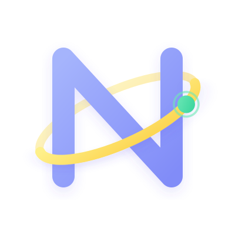

<div align="center">
  

# Newton

**A dynamically typed, compiled, and interpreted systems programming language for rapid prototyping and high-performance execution.**

[](LICENSE)
[]()
[]()

</div>

---

## What is Newton?

Newton is a pseudo-general-purpose programming language designed to combine the rapid prototyping ergonomics of high-level scripting languages (like Python and Lua) with the execution speed and bare-metal control of native systems languages.

- **Clean, Minimalist Syntax**: Dynamically typed with explicit scoping, eliminating boilerplate while remaining mechanically transparent.
- **Fast Native Compilation**: Compiles directly to standalone, zero-dependency machine code binaries via the GravityVM native x86_64 toolchain.
- **AST Optimization Engine**: Multi-pass optimizer featuring constant folding, algebraic simplification, and Tail Call Optimization (TCO) that converts tail recursion into flat hardware jumps.
- **Zero-Friction C FFI**: Directly invoke C library functions with `#func` syntax and expose Newton functions back to C using `exposed fun`. Includes the canonical `newton.h` integration header.
- **Rich Standard Library**: Built-in modules for high-level TCP/HTTP networking (`std::web`), collection manipulation (`std::collection`), string utilities (`std::string`), system processes (`std::process`), file I/O (`std::file`), and mathematics (`std::math`).

---

## Quick Start

### 1. Requirements & Building the Compiler

Newton requires [Nim](https://nim-lang.org/) (>= 2.0) and standard assembler/linker tools (`as`, `ld`, `gcc`).

```bash
# Clone the repository
git clone https://github.com/Healing-A-Dev/Newton.git
cd Newton

# Compile and install to ~/.newton
# Make sure to include ~/.newton/bin in your $PATH
make && make install
```

### 2. Hello, World!

Create a file named `hello.nt`:

```crystal
fun main:
    @println "Hello from Newton!"
end
```

Run it immediately:

```bash
newton run hello.nt
```

Compile it to a native, standalone binary:

```bash
newton build hello.nt -o hello
./hello

or

newton hello.nt
./hello
```

---

## Language Features at a Glance

### Variables & Operations

```crystal
fun main:
    ; Variables are defined with 'set' and assigned with ':'
    set name: "Alice"
    set age: 30

    ; Reading a variable requires the '$' prefix
    @println "Name: {} | Age: {}", $name, $age

    ; Expression grouping with parentheses
    set total: ($age + 10) * 2
    @println "Total: {}", $total
end
```

### Collections & Destructuring

```crystal
fun main:
    ; Lists are declared with []
    set numbers: [10, 20, 30]

    ; Maps are declared with ()
    set user: (name: "Alice", role: "Developer", active: 1)

    ; Direct index and key access with {}
    @println "First number: {}", $numbers{0}
    @println "User role: {}", $user{"role"}

    ; Polymorphic collection printing (works on nested maps and lists)
    @println "User map: {}", $user

    ; List destructuring
    set [x, y, z]: $numbers
    @println "Unpacked: {} {} {}", $x, $y, $z
end
```

### Control Flow & Loops

```crystal
fun main:
    ; Conditionals (supports if, elif, elseif, else)
    set status: 200
    if $status == 200:
        @println "OK"
    elif $status == 404:
        @println "Not Found"
    else:
        @println "Other"
    end

    ; Pattern matching
    match $status:
        200 -> @println "Success!"
        404 -> @println "Missing!"
    end

    ; While loop
    set count: 0
    while $count < 3:
        @println "Count: {}", $count
        count: $count + 1
    end

    ; Numeric for loop (start, end, step)
    for &i, 0, 5, 1:
        @println "Index: {}", $i
    end

    ; Flexible foreach loop over collections and strings
    foreach $key, $val in (lang: "Newton", speed: "Fast"):
        @println "{} => {}", $key, $val
    end

    foreach $item in ["alpha", "beta", "gamma"]:
        @println "Item: {}", $item
    end
end
```

### Tail Call Optimization (TCO)

Tail recursion is automatically optimized by the compiler into an iterative loop with zero call stack growth:

```crystal
fun countdown: @args n
    if $n == 0:
        @println "Liftoff!"
        return 0
    end
    return countdown $n - 1
end

fun main:
    ; Will NOT overflow the stack:
    countdown 1000000
end
```

---

## C Foreign Function Interface (FFI)

Newton provides seamless, bidirectional interoperability with C.

### Calling C from Newton

```c
/* math_lib.c */
#include <stdint.h>
#include <newton.h>

int64_t c_add(int64_t a, int64_t b) {
    return NEWTON_INT(a) + NEWTON_INT(b);
}

void c_greet(const char *name) {
    printf("Hello %s from C!\n", NEWTON_STR(name));
}
```

```crystal
; main.nt
fun main:
    #c_greet "Newton Hacker"
    set res: #c_add 40, 2
    @println "Result: {}", $res
end
```

Compile and run in one step:

```bash
gcc -c -fPIC -I~/.newton/include -o math_lib.o math_lib.c
newton run main.nt -l math_lib.o --link-C
```

### Calling Newton Functions from C

Expose functions to C using `exposed fun` and invoke them using `NEWTON_CALL` macros:

```crystal
; newton_func.nt
exposed fun multiply: @args a, b
    return $a * $b
end
```

```c
/* caller.c */
#include <newton.h>

extern void F_multiply(void);

void call_from_c(void) {
    int64_t res = NEWTON_CALL_2(F_multiply, NEWTON_BOX_INT(6), NEWTON_BOX_INT(7));
    printf("Result from Newton: %ld\n", NEWTON_INT(res)); // Prints 42
}
```

---

## High-Level Networking (`std::web`)

Newton's standard library includes high-level TCP and HTTP client and server APIs:

```crystal
using std::web

fun main:
    ; Create an HTTP server in one line
    set server: web.httpServer 8080
    @println "Listening on http://127.0.0.1:8080..."

    while 1 == 1:
        set client: web.accept $server
        set req: web.serveRequest $client
        if $req{"method"} != "":
            if $req{"path"} == "/":
                web.respondHtml $client, "<h1>Welcome to Newton Web!</h1>"
            elif $req{"path"} == "/api/status":
                web.respondJson $client, "{\"status\": \"healthy\"}"
            else:
                web.respondNotFound $client
            end
        else:
            web.close $client
        end
    end
end
```

Perform HTTP requests effortlessly:

```crystal
using std::web

fun main:
    set res: web.httpGet "http://127.0.0.1:8080/api/status"
    @println "Status: {}", $res{"status"}
    @println "Body: {}", $res{"body"}
end
```

---

## Compiler CLI Reference

```
Usage: newton <command> [<args>] [<flags>]

Commands:
   init <name>     Initialize a new project skeleton.
   build <file>    Compile a Newton file to a native binary.
   run <file>      Compile and immediately run the program.
   lsp             Launch the Language Server Protocol (LSP) daemon.
   help            Display help information.
   version         Display current version.

Options & Flags:
   -o, --output    Specify output binary name.
   -b, --build     Specify compiler backend (native, c).
   -p, --platform  Specify target platform (linux, win64).
   -v, --verbose   Enable verbose compiler and linker output.
   -l <file.o>     Link with an external object file or library.
   -L <dir>        Add a library search directory for the linker.
   --link-C        Automatically link standard C runtime (libc, libm, dynamic linker).
   --noStdlib      Prevent standard library prelude from being automatically imported.
   --script        Execute in scripting mode (.nts).
   -O              Compile directly to an object file (.o).
   -GVM            Emit intermediate GravityVM bytecode (.gvt).
```

---

## Documentation Index

Explore the complete documentation in the [`docs/`](docs/) directory:

- [1. The Basics](docs/01_Basics.md) — Syntax, variables, types, collections, destructuring.
- [2. Control Flow](docs/02_Control-Flow.md) — Conditionals (`if`/`elif`/`else`), pattern matching (`match`), loops (`while`, `for`, `foreach`).
- [3. Functions & TCO](docs/03_Functions.md) — Function declarations, `@args`, scope, first-class calls, and Tail Call Optimization.
- [4. Meta-Programming](docs/04_Meta-Programming.md) — Macro system (`defmacro`), `@` calls, variadic arguments (`$M_ARGV`).
- [5. Ecosystem & Structure](docs/05_Ecosystem-And-Structure.md) — Project layout, namespacing rules, module resolution, CLI options.
- [6. Style Guide](docs/06_Convention.md) — Official naming conventions and formatting standards.
- [7. C FFI Integration](docs/07_FFI.md) — Calling C from Newton, unboxing/boxing, passing collections, invoking Newton callbacks.
- [8. Web & Networking](docs/08_Web_and_Networking.md) — TCP client/server, HTTP request parsing, response formatting, HTTP client (`web.httpGet`, `web.httpPost`).
- [9. Standard Library & Prelude](docs/09_Standard_Library.md) — Complete API index for the Base prelude (`std::Base.nt`), `io`, `string`, `collection`, `math`, `file`, `process`, and `web`.

---

## License

Newton is licensed under the [MIT License](LICENSE).
